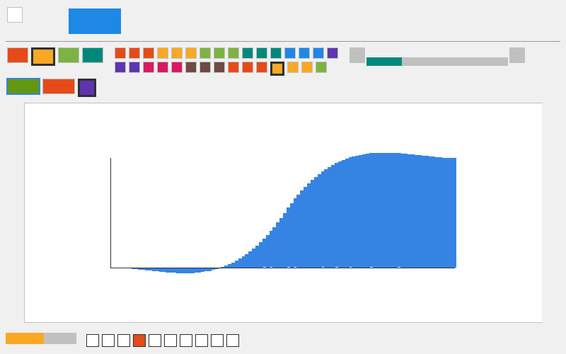

# dvui-animation

Ořezaná verze [DVUI](https://github.com/david-vanderson/dvui) v jazyce C23,
která implementuje **animace**: `Animation` s easingem, mapu animací v okně
se stárnutím a mazáním, časovače, `reduce_motion`, čas do dalšího snímku
z `Window.end` s `Window.waitTime` / `beginWait` a widget **Animate**.
Kreslí přes **SDL 3 GPU**; widgety jsou obdélníky bez textu (box, button
a pomocné spacer, separator, zástupce popisku, overlay). Kód je věrný port
DVUI (commit `2efa35e`, kopie je v `../dvui-original`).



## Dokumentace

- [docs/ANIMACE.md](docs/ANIMACE.md) – jak přesně fungují animace:
  relativní časy, `value` a `done`, easing, mapa animací a značka `used`,
  stárnutí a mazání v `begin`, životnost, návratová hodnota
  `dvui_window_end`, časovače, `reduce_motion`, `waitTime` a `beginWait`,
  AnimateWidget, stateFade.
- [docs/ROZHRANI.md](docs/ROZHRANI.md) – rozhraní: smyčka snímku, animace
  a časovače, Animate, widget a WidgetData, vlastnosti, id, události,
  datové úložiště, kreslení, backend, paměť.
- [docs/ODCHYLKY.md](docs/ODCHYLKY.md) – podrobně, čím se implementace liší
  od DVUI.

Layout a stav mezi snímky jsou stejné jako v projektu dvui-layout
([LAYOUT.md](../dvui-layout/docs/LAYOUT.md),
[STAV.md](../dvui-layout/docs/STAV.md)). Sdílený kód (základní typy,
datové úložiště, backendy) popisuje [shared/README.md](../shared/README.md).

## Co obsahuje

| Část | C API | DVUI originál |
|---|---|---|
| animace | `dvui_Animation`, `dvui_animation_value`, `dvui_animation_done` | `dvui.zig` – `Animation` |
| animace v okně | `dvui_animation`, `dvui_animation_get` | `dvui.animation`, `animationGet`, `Window.animations` |
| časovače | `dvui_timer`, `dvui_timer_get`, `dvui_timer_done`, `dvui_timer_done_or_none`, `dvui_timer_remove` | `dvui.timer*`, `Window.timer`, `timerRemove` |
| omezení pohybu | `dvui_reduce_motion` | `dvui.reduce_motion` |
| easing | `dvui_easing_linear` … `dvui_easing_in_out_bounce`, pole `dvui_easings` | `easing.zig` |
| řízení smyčky | `dvui_window_end` (µs, −1 = null), `dvui_window_wait_time`, `dvui_window_begin_wait`, `dvui_window_max_fps_set` | `Window.end`, `waitTime`, `beginWait`, `max_fps` |
| Animate | `dvui_animate`, `dvui_AnimateWidget` | `widgets/AnimateWidget.zig`, `dvui.animate` |
| box, tlačítko | `dvui_box`, `dvui_button`, `dvui_ButtonWidget` | `BoxWidget.zig`, `ButtonWidget.zig` |
| pomocné | `dvui_spacer`, `dvui_separator`, `dvui_label_placeholder`, `dvui_overlay` | `dvui.spacer`, `separator`, `LabelWidget.zig`, `OverlayWidget.zig` |
| přechody | `dvui_state_fade`, `dvui_hover_fade` | `dvui.stateFade`, `hoverFade` |

## Sestavení

Potřeba: Meson ≥ 1.3, Ninja, překladač C23 (GCC ≥ 13 nebo Clang ≥ 18;
na Windows Clang nebo MinGW-GCC) a pro backend a demo **SDL 3** v systému.

```sh
cd dvui-animation
meson setup build
ninja -C build
meson test -C build             # testy, nepotřebují GPU ani SDL
./build/dvui-animation-demo     # demo
```

Bez SDL 3 se sestaví jen knihovna a testy (`-Dsdl3=disabled` to vynutí).

## Jak se používá

```c
#include "dvui/backend_sdl3gpu.h"

dvui_Sdl3GpuBackend* backend = dvui_sdl3gpu_create((dvui_Sdl3GpuInitOptions){.title = "app", .size = {800, 600}});
dvui_Window* win = dvui_window_create(dvui_sdl3gpu_backend(backend));
bool open = true;
dvui_window_open_flag_set(win, &open);

bool interrupted = false;
while (open) {
    dvui_window_begin(win, dvui_window_begin_wait(win, interrupted));
    dvui_sdl3gpu_add_all_events(backend, win);

    // obsah se při prvním zobrazení „rozsvítí“ za 0,5 s
    dvui_AnimateWidget* a = dvui_animate(DVUI_KIND(DVUI_ANIMATE_ALPHA), DVUI_DURATION(500000),
                                         DVUI_EASING(dvui_easing_out_quad));
    dvui_ButtonWidget bw;
    dvui_button_widget_init(&bw, DVUI_SRC, DVUI_PROPS());
    dvui_Animation wiggle;
    if (dvui_animation_get(bw.wd.id, "xoffset", &wiggle)) {
        /* posun podle dvui_animation_value(&wiggle) */
    }
    dvui_button_widget_process_events(&bw);
    dvui_button_widget_draw_background(&bw);
    dvui_label_placeholder(DVUI_LABEL_SIZE(40, 12));
    if (dvui_button_widget_clicked(&bw)) {
        dvui_animation(bw.wd.id, "xoffset", (dvui_Animation){.start_val = 0, .end_val = 1, .end_time = 500000});
    }
    dvui_button_widget_deinit(&bw);
    dvui_animate_widget_deinit(a);

    const int32_t end_micros = dvui_window_end(win);   // 0 = hned, >0 = za tolik µs, −1 = čekat
    interrupted = dvui_sdl3gpu_wait_event_timeout(backend, dvui_window_wait_time(win, end_micros));
}

dvui_window_destroy(win);
dvui_sdl3gpu_destroy(backend);
```

Poznámky:

- Časy animací jsou v **mikrosekundách relativně k aktuálnímu snímku**.
- `dvui_Animation` nemá v C výchozí hodnoty: `easing == NULL` je linear,
  ale `end_val` je třeba zadat (DVUI výchozí 1).
- Animace žije, jen dokud se na ni někdo každý snímek ptá (viz
  [ANIMACE.md](docs/ANIMACE.md), kap. 6).
- Vlastnosti widgetů jsou seznam značek jako v dvui-layout
  (`DVUI_KIND`, `DVUI_DURATION`, `DVUI_EASING` u Animate).

## Struktura

```
include/dvui/dvui.h          veřejné API (vkládá sdílené dvui/base.h)
src/animation.c              Animation, animation/animationGet, časovače, reduce_motion
src/easing.c                 easing funkce
src/window.c                 Window (vč. stárnutí animací, end, waitTime, beginWait)
src/core.c                   Options, téma, placeIn
src/frame.c                  aréna snímku, seznamy příkazů kreslení
src/widget_data.c            WidgetData
src/layout.c                 BasicLayout
src/widgets/animate.c        AnimateWidget
src/widgets/box.c, button.c, simple.c   box, tlačítko, spacer, separator, zástupce popisku, overlay
tests/test_animation.c       testy (testovací backend)
examples/demo.c              demo podle DVUI Examples/animations.zig
```

Sdílený kód je v `../shared/` (soubory se v `meson.build` uvádějí cestou
`../shared/…`): základní typy, geometrie, datové úložiště, backendy SDL 3
GPU a testovací, shadery.

## Odchylky od DVUI

Podrobně v [docs/ODCHYLKY.md](docs/ODCHYLKY.md); stručně:

- **`dvui_Animation` bez výchozích hodnot polí:** `easing == NULL` = linear,
  `end_val` je nutné zadat.
- **Nepovinné hodnoty:** `?u32` z `Window.end` je `int32_t` s −1 = null,
  `animationGet` / `timerGet` vracejí `bool` a hodnotu přes ukazatel,
  `max_fps` 0 = null.
- **AnimateWidget:** `kind` a `duration` nejsou povinné (výchozí `NONE`
  a 0).
- **waitTime:** bez podřízených oken OS (`child_os_wins`).
- **Vynecháno oproti dvui-layout:** scroll, grid, plovoucí widgety, Scale;
  `dvui_scroll_to` je prázdná funkce.
- **Převzato z dvui-layout:** API vlastností jako seznam značek, id z
  adresy literálu, bez textu, jediné téma, `malloc`/`free` a `abort()` při
  nedostatku paměti, zúžené backendy (navíc `sleep`).
- **Demo:** bez textu, rozbalovacích seznamů, posuvníku, plovoucích oken
  a dialogů; graf easingu je řada obdélníků.

## Testy

`tests/test_animation.c` běží s testovacím backendem (bez GPU); každý
snímek posune čas o 16 ms. Kontroluje easingy (okraje 0 a 1, známé
hodnoty, přesah back/elastic), `Animation.value`/`done`, životnost animace
v mapě (poslední snímek `done`, pak zmizí; nepoužitá zmizí), návratovou
hodnotu `dvui_window_end` (běžící animace, budoucí animace, časovač),
časovače (`timer_done` přesně jednou, periodický časovač),
`reduce_motion`, AnimateWidget (výška/šířka během vertical/horizontal,
alfa vykreslených obdélníků) a `waitTime`/`beginWait` (slop, `max_fps`).
Na začátku jsou základní testy layoutu převzaté z dvui-layout.
