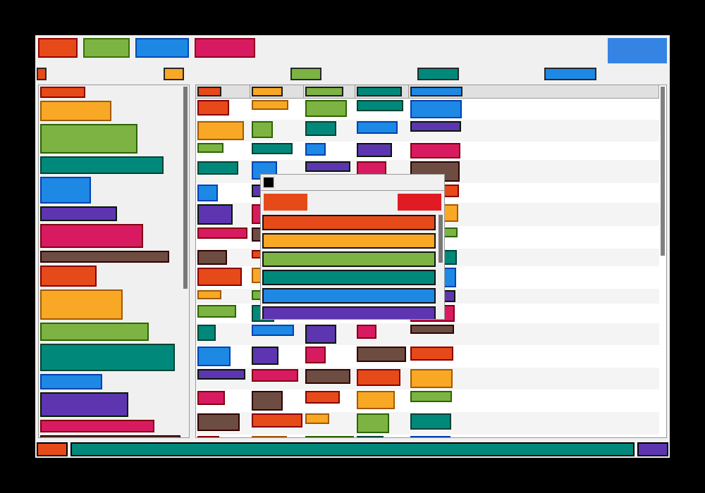

# dvui-layout

Ořezaná verze [DVUI](https://github.com/david-vanderson/dvui) v jazyce C23,
která dělá **layout widgetů** a kreslí je přes **SDL 3 GPU**. Widgety jsou
obdélníky s výplní a okrajem (bez textu, s ostrými rohy). Kód layoutu je věrný
port DVUI (commit `2efa35e`, kopie je v `../dvui-original`).



## Dokumentace

- [docs/LAYOUT.md](docs/LAYOUT.md) – jak přesně funguje layout: vrstvy obdélníku,
  co z WidgetData a Options vstupuje do výpočtu, algoritmy jednotlivých
  kontejnerů (box, scroll, grid, plovoucí okna), konvergence přes více snímků.
- [docs/ROZHRANI.md](docs/ROZHRANI.md) – základní rozhraní: smyčka snímku,
  `dvui_Widget` a `WidgetData`, vlastnosti widgetů, id, události, capture a fokus,
  datové úložiště, kreslení, backend, správa paměti a příklad vlastního widgetu.
- [docs/STAV.md](docs/STAV.md) – držení stavu mezi snímky: min. velikosti
  a datové úložiště (hashovací mapy podle id), úklid nepoužitých položek,
  capture, fokus a subwindows, klíče používané widgety.
- [docs/ODCHYLKY.md](docs/ODCHYLKY.md) – podrobně, čím se implementace liší
  od DVUI: převod ze Zigu do C, API vlastností, id, vynechané vlastnosti
  a funkce, změněné chování, paměť, backendy a vliv na layout.
- [docs/NEIMPLEMENTOVANO.md](docs/NEIMPLEMENTOVANO.md) – kontejnery z DVUI,
  které zatím chybí (Paned, FlexBox, Reorder, Tabs, menu, Docking, …): co
  dělají, jak těžké by bylo je doplnit a co chybí v jádru.

## Widgety

| Widget | C API | DVUI originál |
|---|---|---|
| box (vodorovný i svislý, `equal_space`) | `dvui_box`, `dvui_BoxWidget` | `widgets/BoxWidget.zig` |
| tlačítko (bez textu, klikatelné) | `dvui_button`, `dvui_ButtonWidget` | `widgets/ButtonWidget.zig` |
| scroll area / container / bar | `dvui_scroll_area`, `dvui_ScrollContainerWidget`, `dvui_ScrollBarWidget` | `widgets/Scroll*Widget.zig`, `ScrollInfo.zig` |
| grid (vícepruchodový layout) | `dvui_grid`, `dvui_GridWidget` | `widgets/GridWidget.zig` |
| tooltip | `dvui_tooltip`, `dvui_FloatingTooltipWidget` | `widgets/FloatingTooltipWidget.zig` |
| plovoucí okno + lišta | `dvui_floating_window`, `dvui_window_header` | `widgets/FloatingWindowWidget.zig`, `dvui.windowHeader` |
| pomocné | `dvui_spacer`, `dvui_separator`, `dvui_label_placeholder`, `dvui_overlay`, `dvui_ScaleWidget`, `dvui_FloatingWidget` | `dvui.zig`, `LabelWidget.zig`, `OverlayWidget.zig`, `ScaleWidget.zig`, `FloatingWidget.zig` |

## Sestavení

Potřeba: Meson ≥ 1.3, Ninja, překladač C23 (GCC ≥ 13 nebo Clang ≥ 18;
na Windows Clang nebo MinGW-GCC) a pro backend a demo **SDL 3** v systému
(hledá se přes pkg-config/CMake jako `sdl3`).

```sh
cd dvui-layout
meson setup build
ninja -C build
meson test -C build          # testy layoutu, nepotřebují GPU ani SDL
./build/dvui-layout-demo     # demo (Vulkan / Metal / D3D12 přes SDL 3 GPU)
```

Bez SDL 3 se sestaví jen knihovna a testy (`-Dsdl3=disabled` to vynutí).

## Jak se používá

Stejně jako DVUI je to immediate-mode GUI: každý snímek se widgety znovu
„deklarují“ a layout se ustálí během několika snímků (min. velikosti se pamatují
z minulého snímku).

```c
#include "dvui/backend_sdl3gpu.h"

dvui_Sdl3GpuBackend* backend = dvui_sdl3gpu_create((dvui_Sdl3GpuInitOptions){.title = "app", .size = {800, 600}});
dvui_Window* win = dvui_window_create(dvui_sdl3gpu_backend(backend));
bool open = true;
dvui_window_open_flag_set(win, &open);

while (open) {
    dvui_window_begin(win, (int64_t)SDL_GetTicksNS());
    dvui_sdl3gpu_add_all_events(backend, win);

    dvui_BoxWidget* row = dvui_box(DVUI_DIR(DVUI_HORIZONTAL), DVUI_EXPAND(DVUI_EXPAND_HORIZONTAL));
    if (dvui_button(DVUI_LABEL_SIZE(40, 12), DVUI_FILL(DVUI_RGB(200, 60, 30)))) {
        // kliknuto
    }
    dvui_box_widget_deinit(row);

    const int32_t wait = dvui_window_end(win);   // 0 = hned, −1 = čekat na událost
    dvui_sdl3gpu_wait_event_timeout(backend, wait < 0 ? UINT32_MAX : (uint32_t)wait);
}

dvui_window_destroy(win);
dvui_sdl3gpu_destroy(backend);
```

Poznámky k API:

- Widget dostává **jeden seznam vlastností** (značka + hodnota), ve kterém
  jsou společné vlastnosti (DVUI `Options`) i vlastnosti widgetu (DVUI
  `InitOptions`). Co v seznamu není, má výchozí hodnotu jako v DVUI.
  Podrobně v [docs/ROZHRANI.md](docs/ROZHRANI.md), kap. 3.
- `DVUI_SRC` nahrazuje Zig `@src()`; id widgetu vzniká z id rodiče, adresy
  místa ve zdrojáku (řetězcový literál `"soubor:řádek:čítač"`) a `id_extra`. Ve smyčce předávejte `DVUI_ID_EXTRA(i)`.
  Makra `dvui_box(…)` apod. doplňují `DVUI_SRC` sama.
- Widget lze vytvořit buď ve vlastní paměti
  (`dvui_box_widget_init(&box, DVUI_SRC, DVUI_PROPS(…))`), nebo „pohodlným“
  makrem (`dvui_box(…)`), které ho alokuje; v obou případech se ukončuje
  `*_deinit`.

## Struktura

```
include/dvui/dvui.h               veřejné API (vkládá sdílené dvui/base.h)
src/core.c                        Options, téma, placeIn, geometrie závislá na okně
src/frame.c                       alokace v aréně snímku, seznamy příkazů kreslení
src/window.c                      Window, události, capture, fokus, subwindows,
                                  funkce datového úložiště, renderovací fronta
src/widget_data.c                 WidgetData
src/layout.c                      BasicLayout, placeOnScreen
src/widgets/                      widgety
tests/test_layout.c               testy layoutu
examples/demo.c                   demo
```

Projekt používá sdílený kód z `../shared/` (soubory se v `meson.build`
uvádějí cestou `../shared/…`), viz [shared/README.md](../shared/README.md):

```
../shared/include/dvui/base.h             základní typy, rozhraní backendu
../shared/include/dvui/data.h, util.h     aréna, hash mapa, datové úložiště, logování
../shared/include/dvui/backend_*.h        backend SDL 3 GPU a testovací backend
../shared/src/                            id, geometrie a barvy, data, backendy
../shared/shaders/                        předkompilované shadery z DVUI
../shared/tools/embed.c                   vložení shaderů do C (náhrada #embed)
```

## Odchylky od DVUI

Layout (placeIn, BasicLayout, BoxWidget, ScrollContainer/ScrollArea,
GridWidget, plovoucí widgety, min. velikosti z minulého snímku, refresh,
datové úložiště a jeho klíče) odpovídá DVUI a dává stejné obdélníky.
Podrobný přehled všech odchylek je v [docs/ODCHYLKY.md](docs/ODCHYLKY.md);
stručně:

- **API:** místo struktur `Options` a `InitOptions` s poli `?T` dostává
  widget jeden seznam vlastností (`dvui_Prop`); několik vlastností je
  přejmenovaných (`dir`, `tooltip_scale`, `rect_io`, `resizable`,
  `label_size`).
- **Id:** do id vstupuje adresa literálu `"soubor:řádek:čítač"`, který
  vytvoří `DVUI_SRC` (DVUI hashuje ukazatel na jméno souboru, řádek
  a sloupec).
- **Vynecháno:** text a fonty (místo popisku je zástupce s `label_size`,
  `Font.sizeM` je konstanta 9×12), zaoblené rohy, stíny, gradienty,
  ninepatch, rotace, ikony, textury a render targety, animace a časovače
  (kromě `hoverFade`), klávesová navigace a `FocusGroupWidget`, dotyk
  (jeden capture a jedno tažení), AccessKit, dialogy, toasty, ladicí okno,
  víc oken OS, část gridu (kurzor, klávesnice, editace, řazení) a widgety
  z [docs/NEIMPLEMENTOVANO.md](docs/NEIMPLEMENTOVANO.md).
- **Změněno:** jediné téma (Adwaita Light, nenastavená barva =
  `{0, 0, 0, 0}`), `Color.lighten` v CIE LCh(uv) místo HSLuv,
  `dvui_window_end` vrací jen 0 / −1 (bez animací), chybí `waitTime`, datové úložiště kontroluje typ jen
  velikostí.
- **Paměť:** bez vlastních alokátorů (`malloc`/`free`, vlastní aréna
  snímku), při nedostatku paměti `abort()`.
- **Sdílený kód:** základní typy, geometrie, datové úložiště
  (`dvui_DataStore`) a backendy jsou v `../shared/`; chování to nemění.
- **Backendy:** zúžené rozhraní (bez textur, schránky, víc oken); SDL 3 GPU
  maže okno barvou pozadí, má jen bílou texturu 1×1 a 32bitové indexy.

## Testy

`tests/test_layout.c` běží s testovacím backendem (bez GPU) a kontroluje
obdélníky po ustálení layoutu: `placeIn`, `placeOnScreen`, box (svislý,
vodorovný s roztažením, `equal_space`), velikost a kliknutí tlačítka,
scroll area (virtuální velikost, posuvník, kolečko, mez scrollování), grid
(auto-size sloupců a řádků přes víc snímků), plovoucí okno (auto-size,
centrování, přetažení) a tooltip (zobrazení a skrytí podle myši).
